# DECK — Historical Log Extraction, Physical Auditing & Archival Intelligence

[](https://www.python.org/downloads/)
[](https://opensource.org/licenses/MIT)
[]()

> **DECK** (Document Extraction, Calibration & Knowledge-engine) transforms degraded historical deck logs, engine room machinery journals, and bell books into high-fidelity structured databases, audited by thermodynamic physics models and linked directly to raw scan imagery via interactive reticle optics.

---

## The Challenge

Centuries of mission-critical maritime operations, industrial maintenance logs, and wartime naval history remain trapped in paper archives. Digitizing these records at scale presents three major obstacles:
1. **Severe Degradation:** Typewritten carbon copies, bleed-through ink, yellowing pulp, and handwritten cursive break standard cloud OCR pipelines.
2. **Missing Ground Truth & Spatial Context:** Typical text extraction discards spatial geometry, making auditability and human-in-the-loop verification laborious.
3. **Absence of Domain Logic:** Standard vision-language models transcribe physically impossible readings without warning (e.g., negative fuel consumption, impossible RPM/knot ratios, or thermodynamic casualty conditions).

---

## The Solution: DECK

**DECK** is an end-to-end intelligent document platform designed for naval historians, archival engineers, and fleet analysts. It combines multi-channel intake, dual-pass optical recognition, spatial reticle calibration, and deterministic thermodynamic validation.

```
┌─────────────────┐     ┌──────────────────┐     ┌─────────────────────┐     ┌─────────────────────┐
│ Multi-Channel   │ ──> │ Layout Survey &  │ ──> │ Dual-Pass OCR &     │ ──> │ Physical Auditing & │ ──> Master Exports
│ Intake (6 Modes)│     │ Template Matching│     │ Reticle Calibration │     │ BUSHIPS Verification│     (.xlsx, .docx, HTML)
└─────────────────┘     └──────────────────┘     └─────────────────────┘     └─────────────────────┘
```

---

## Key Highlights for Judges

### 1. Multi-Modal Information Intake (6 Distinct Ingestion Channels)
DECK accommodates real-world field conditions across any scanning infrastructure:
- **Batch Archival PDFs:** Multi-hundred-page historical logbooks (e.g., USS *Gilmer* DD-233).
- **Flatbed & Mobile Scans:** Single-page high-resolution PNG, JPG, and TIFF records.
- **Live Document Camera / USB Webcam:** Real-time snapshot capture from physical document stands.
- **MFP Network Hotfolder Watcher:** Automated background filesystem polling for networked office copiers.
- **Direct Tabular Key Entry:** Low-latency spreadsheet editor for rapid human data entry and override.
- **Technical Manual Knowledge Base:** Direct ingestion of Bureau of Ships (BUSHIPS) engineering manuals for ground-truth operational bounds.

### 2. Optical Reticle Calibration & Interactive Zoom
- Dual-pass OCR combines structural line extraction with consensus text reading.
- Every extracted data point retains its normalized bounding box `[x, y, w, h]`.
- Hovering or clicking any cell in the data grid summons a **3.2× Optical Inspection Reticle**, spotlighting the exact pixels on the raw scanned document for immediate verification.
- Low-confidence extractions ($<70\%$) are flagged with audit warnings for human review.

### 3. Physical Sanity & Thermodynamic Anomaly Engine
DECK doesn't just read text — it understands naval propulsion physics:
- **Mass Continuity:** Audits daily fuel oil and boiler feed water conservation balances ($\text{Received} - \text{Expended} = \Delta \text{Storage}$).
- **Kinematic Curves:** Cross-validates recorded propeller shaft RPM against ship speed (knots) to flag cavitation or logging errors.
- **Thermodynamic Operating Envelopes:** Flags boiler casualties, steam pressure drops, and engineering anomalies against official BUSHIPS technical standards (Chapters 41, 51, 55, 58).

### 4. Master Archival Artifact Generation
Populates structured data directly into authentic digital replicas of historical US Navy forms:
- **Form 4-2600:** US Navy 24-Hour Deck Log Master Spreadsheet (`.xlsx`)
- **Form NEng-10:** Engineering Machinery Log Sheet & Bell Book (`.xlsx` & `.docx`)
- **Form NNav-45 / 46 / 52:** Narrative Remarks & Official Title Covers (`.docx`)
- **Zero-Server Portable HTML Bundle:** Standalone single-file HTML export containing embedded images, interactive charts, and search filters that run completely offline without web servers.

### 5. Focused, Clutter-Free Operator Interface
Designed according to strict military ergonomics and archival readability:
- High-contrast slate and ivory colorway with an 8-point mariner's compass navigation motif.
- Clean two-mode entry view: **Review Existing Data** vs. **Upload & OCR Extractor**.
- Zero generic clip art or decorative AI artifacts.

---

## System Architecture

```mermaid
flowchart TD
    subgraph Intake["Stage 1: Multi-Channel Information Intake"]
        A["Channel A: Scanned Multi-Page PDF\n(Batch archival files, e.g., Gilmer DD-233)"]
        B["Channel B: Flatbed & Photo Scans\n(Single page PNG, JPG, TIFF)"]
        C["Channel C: Live Document Camera\n(Direct USB webcam capture)"]
        D["Channel D: MFP Network Watcher\n(Automated filesystem hotfolder polling)"]
        E["Channel E: In-App Tabular Grid\n(Manual keystroke entry & quick override)"]
        F["Channel F: Technical Manual Library\n(BUSHIPS PDFs & engineering references)"]
    end

    subgraph Preprocessing["Stage 2: Layout Survey & Template Classification"]
        P1["Document Geometry & Line Detection\n(Aspect ratio, grid skew correction, form headers)"]
        P2{"Form Template Classifier\n(Bayesian layout matcher)"}
        P3["Standard Logsheet Profile\n(DD-233, Standard 24h, NavLog)"]
        P4["Flexible Grid Fallback\n(Coordinate anchor discovery)"]
    end

    subgraph Extraction["Stage 3: OCR & Reticle Calibration Engine"]
        E1["Dual-Pass Optical Character Recognition\n(Tesseract OCR + EasyOCR consensus engine)"]
        E2["Spatial Reticle Coordinate Mapping\n(Normalized [x, y, w, h] bounding box registration)"]
        E3["Confidence Scoring & Ambiguity Flagging\n(Confidence < 70% marked for human audit)"]
    end

    subgraph Reasoning["Stage 4: Physical Auditing & Anomaly Engine"]
        R1["Mass Continuity & Volume Check\n(Daily Fuel/Water balance conservation)"]
        R2["Thermodynamic & Kinematic Bounds\n(Speed vs. RPM slip ratio curves)"]
        R3["Casualty & Event Flagging\n(Boiler tube rupture, steering failure)"]
        R4["BUSHIPS Tech Reference Verification\n(Chapters 41, 51, 55, 58 cross-referencing)"]
    end

    subgraph Output["Stage 5: User Interface & Export Channels"]
        O1["Telemetry & Consumption Trends\n(Speed, fuel rate, boiler pressure over time)"]
        O2["Point-to-Scan Reticle Zoom\n(3.2x optical inspection reticle hover)"]
        O3["Populated Excel / Word Artifacts\n(Direct export to master templates)"]
        O4["REST API & Portable HTML Bundle\n(Self-contained offline review archive)"]
    end

    Intake --> Preprocessing
    P1 --> P2
    P2 -->|Known Template| P3
    P2 -->|Custom Layout| P4
    P3 --> Extraction
    P4 --> Extraction
    Extraction --> Reasoning
    Reasoning --> Output
```



---

## Quickstart Guide

### Prerequisites
- Python 3.10+
- Git

### Installation

1. **Clone the repository:**
   ```bash
   git clone https://github.com/Acaellum/Deck.git
   cd Deck
   ```

2. **Create and activate a virtual environment:**
   ```bash
   python -m venv .venv
   # Windows PowerShell:
   .\.venv\Scripts\Activate.ps1
   # Linux/macOS:
   source .venv/bin/activate
   ```

3. **Install dependencies:**
   ```bash
   pip install fastapi uvicorn pillow openpyxl python-docx pymupdf
   ```

4. **Launch the application:**
   ```bash
   python app.py
   ```
   Open your browser and navigate to: **`http://localhost:8000`**

---

## Project Structure

```
Deck/
├── app.py                      # FastAPI server & REST API endpoints
├── run_app.bat                 # One-click Windows launch script
├── generate_flowchart_image.py # Architecture flowchart generator
├── engine/
│   ├── ocr_extractor.py        # Optical recognition & reticle coordinate mapper
│   ├── intelligent_extractor.py# Multi-pass semantic table extraction
│   ├── anomaly_analyzer.py     # Thermodynamic & mass conservation physics rules
│   ├── template_selector.py    # Form profile & template matcher
│   ├── template_populator.py   # Word (.docx) & Excel (.xlsx) form generator
│   └── machinery_logs.py       # Boiler & propulsion journal parser
├── static/
│   ├── index.html              # Archival operator interface & review portal
│   ├── deck_logo.svg           # Symmetrical mariner's compass rose
│   ├── deck_app_flowchart.png  # High-resolution architectural diagram
│   └── chart.min.js            # Offline telemetry graphing library
└── templates/
    └── template_catalog.json   # Specification schemas for historical naval logs
```

---

## Technology Stack

- **Backend:** Python 3, FastAPI, Uvicorn
- **Image Processing & Document Parsing:** PyMuPDF (`fitz`), Pillow, OpenCV
- **Office Artifact Generation:** `openpyxl`, `python-docx`
- **Frontend:** Vanilla HTML5 / Modern CSS / ES6 JavaScript (Zero heavy UI framework bloat, fast 60fps rendering)
- **Visualization:** Chart.js (offline bundled), Mermaid.js

---

## Future Roadmap

- **Whisper Voice-to-Log Audio Scribe:** Audio log transcription for spoken bridge dictations.
- **On-Device Quantized SLM (Gemma-3-4B):** Local edge inference for zero-network vessel deployments.
- **3D Hull & Compartment Spatial Mapping:** Direct correlation between damage log entries and 3D ship compartment models.
